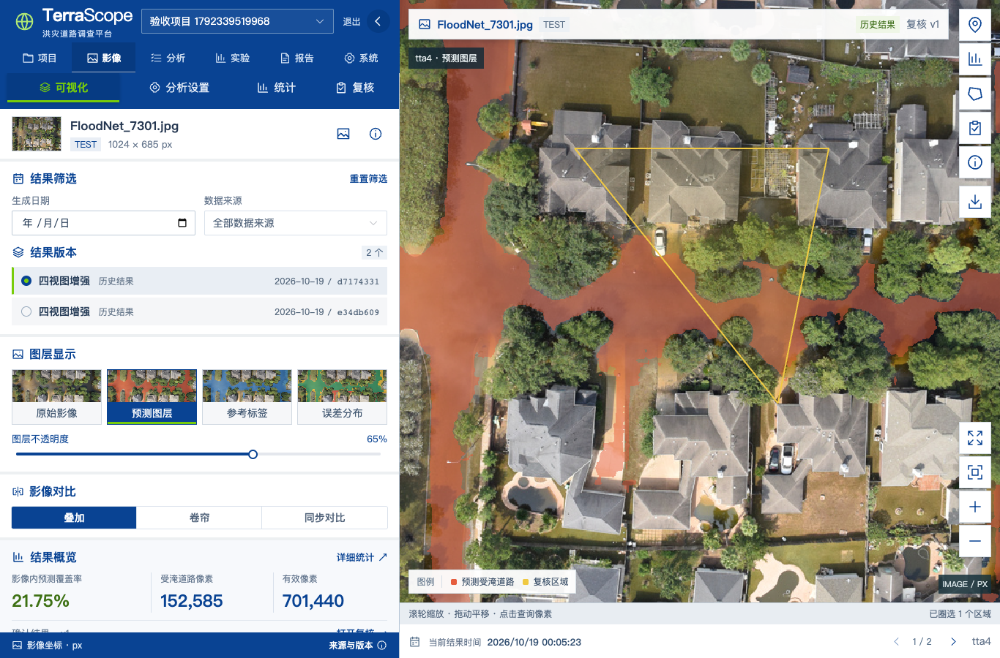

# TerraScope 洪灾道路智能解译与调查平台

从 RGB 航拍影像识别受淹道路，完成像素统计、人工复核、实验对照与报告导出。本仓库整理了本组截至 **2026-10-30** 的实验方案、训练与推理代码、最终微调权重、前后端工程、设计与汇报材料。研究记录主要形成于 2026-10-12 至 2026-10-20。

本项目基于上游 [TerraScope / Earth-Observation-VLMs](https://github.com/shuyansy/Earth-Observation-VLMs)，增加洪灾道路任务适配与调查平台工程。**不包含数据集原图、语义标签、缩略图库或数据集压缩包。** 保存的统计 JSON、划分与哈希清单、模型预测掩膜、成品图件和系统截图属于实验记录与展示材料。



## 从哪里开始

| 目的 | 入口 |
| --- | --- |
| 运行前后端 | 下方快速启动、[部署说明](docs/deployment.md) |
| 实验设计与全部对照 | [实验总览](experiments/README.md)、[最终配置](experiments/configs/final.json) |
| 结果与结论边界 | [最终方案选择](experiments/summaries/01_最终实验/最终方案选择.json)、[指标口径](experiments/summaries/指标口径与结论边界.md) |
| 权重与 GPU | [权重说明](weights/README.md)、[GPU 服务](model_service/README.md) |
| 接入本地数据 | [数据准备](docs/data.md) |
| UI、接口与系统设计 | [架构](docs/architecture.md)、[UI 设计](docs/ui-design.md)、[OpenAPI](docs/openapi.json)、[总体方案](docs/design/TerraScope_功能设计与总体技术方案_v1.0.docx) |
| 课堂汇报与演示 | [当前 PPT](docs/presentations/TerraScope_课堂汇报.pptx)、[展示材料](docs/showcase/)、[演示视频](docs/showcase/TerraScope_演示_20261020.mov) |
| 来源与完整性 | [归档说明](docs/repository/README.md)、[文件来源](docs/repository/source-map.json)、[验证记录](docs/repository/validation.md) |

## 已实现功能

- 项目、成员与权限管理，RGB 上传，案例检索和可选 GPS 拍摄点地图。
- FastAPI 业务 API、持久化异步任务、独立 GPU 推理，支持单视图与四视图策略。
- OpenLayers 像素判读：叠加、卷帘、同步对比、像素查询、区域圈选与版本化人工复核。
- 按输入 SHA256、分区、模型和策略匹配历史结果；新影像执行真实推理或导入对应外部掩膜。
- 实验统计与 CSV 导出；中文 PDF、PNG 和 ZIP 证据包，报告绑定固定结果与复核版本。

当前阶段为 P0 原型。分割结果采用像素坐标；GPS 是相机拍摄点，不是正射配准。没有可靠地理分辨率时，不将覆盖率转换成面积或道路长度。人工复核记录意见与区域，不改写原始预测。

## 最终实验方案

输入为 FloodNet RGB，目标为 flooded roads（类别 3），255 为无效标签。冻结视觉与语言主干，仅训练 `text_hidden_fcs` 和 SAM2 `sam_mask_decoder`，共 **17,981,509** 个可训练参数。

| 设置 | 最终采用 |
| --- | --- |
| 数据划分 | 训练 300、验证 80、测试 448、同事件额外留出 370 |
| 训练目标 | BCE + binary Lovász hinge |
| 优化器 | AdamW；学习率 1e-4；weight decay 0.01；梯度裁剪 1.0 |
| 训练长度 | 4,800 微步，累计 4 次，共 1,200 次更新 |
| 种子 | 20261015 / 20261016 / 20261017；最终选 20261017 第 4,800 微步 |
| 选模依据 | 80 幅验证集全局像素 IoU |
| 最终推理 | 原图、水平翻转、垂直翻转、双向翻转；logits 逆变换后平均 |
| 二值化 | 双线性恢复原尺寸后 `logit > 0` |
| 固定指令 | `Segment the flooded roads in this aerial image.` |
| 固定助手前缀 | `The flooded road regions are [SEG]` |

最终没有启用语言 LoRA、额外空间提示模块或跨种子权重平均，这些作为对照保留。历史协议可能含未启用的 LoRA 字段，应结合实际模块开关阅读。

| 分区 | 策略 | 全局 IoU | 全局 Dice | 覆盖率 MAE（百分点） | 场景命中 / 误报数 |
| --- | --- | ---: | ---: | ---: | ---: |
| 测试 448 | 单视图 | 58.63% | 73.92% | 0.8103 | 45 / 4 |
| 测试 448 | **四视图（最终）** | **58.28%** | **73.64%** | **0.8334** | **44 / 2** |
| 留出 370 | 单视图 | 52.06% | 68.47% | 0.7039 | 21 / 10 |
| 留出 370 | **四视图（最终）** | **55.69%** | **71.54%** | **0.5975** | **21 / 1** |

四视图在验证集达到 63.92% IoU，主要改善误报与额外留出集表现；测试 IoU 略低于单视图。场景阈值是受淹道路覆盖率至少 1%，覆盖率分母为有效像元。448 幅测试集此前用于过项目探索；370 幅留出与训练数据来自同一灾害事件，不能证明跨事件或跨地区泛化。这些数值来自归档的原始统计，此次没有重新训练。

## 快速启动

权重、PPT、PDF、字体与视频使用 **Git LFS**。先安装 [Git LFS](https://git-lfs.com/)，再执行：

```sh
git lfs install
git clone https://github.com/machenxi722/TerraScope.git
cd TerraScope
git lfs pull
python3 scripts/verify_repository.py
```

### Docker Compose

需要 Docker Engine / Docker Desktop、Compose 和 Python 3。

```sh
python3 scripts/configure.py
docker compose up --build -d
python3 scripts/healthcheck.py
```

访问 `http://127.0.0.1:8080`。管理员及随机密码保存在本机 `.env`，不要提交。首次启动完成数据库迁移和管理员初始化；没有示例数据时直接进入空项目状态。

### 本地开发

业务环境为 Python 3.12、Node.js 22+，与 GPU 环境分开安装。

```sh
python3.12 -m venv .venv
.venv/bin/python -m pip install -r backend/requirements.lock
cd frontend
npm ci
cd ..
.venv/bin/python scripts/dev.py
```

访问 `http://127.0.0.1:5173`。本地模式为 SQLite + 数据库轮询 Worker；Compose 为 PostgreSQL + Redis + Celery。Windows 可用 Docker 脚本 `scripts/start-windows.ps1`。

**首次使用：**登录 → 新建项目 → 上传自己的 RGB → 接入 GPU 后选“本次推理”，或导入匹配的外部结果 → 判读复核 → 导出报告。无数据集时案例库为空，实验评估页仍可看已有统计。初始化示范项目会提示先安装数据。

恢复原历史案例需按 [数据说明](docs/data.md) 安装本地资料；默认仓库不能直接执行依赖 7301 等原始影像的演示步骤。

## 权重与 GPU

最终增量：`weights/long_bce_lovasz_seed20261017_best_delta.pt`，**71,979,524 字节**，SHA256：

```text
7c70b717815a39b66c052748c44256b685d17ef1513ee482084ce6419d93dfa8
```

这是投影层和掩膜解码器增量，需要完整底座。约 32 GB 的上游底座不在本地工作目录中，未复制进入 Git；固定上游版本、已有底座文件清单、校验和启动命令见 [权重说明](weights/README.md)。其他对照 checkpoint 未交接到本地，仅保存其协议、结果与预测，不声称这些参数已经上传。

服务只接收 RGB，不接收参考标签；引擎核验底座清单、增量摘要、键集合和张量形状。令牌只由后端保存。历史 GPU 验收见 [docs/evidence](docs/evidence/)；此次归档没有启动付费 GPU。

## 工程结构

```text
backend/                 FastAPI、SQLAlchemy、Alembic、Worker、测试
frontend/                Vue 3、TypeScript、Vite、Element Plus、OpenLayers
model_service/           独立 PyTorch CUDA 服务与 RGB-only 推理
infra/                   Nginx 同源代理
scripts/                 配置、启动、数据安装、部署、备份、校验
data/fonts/              中文字体与 OFL 许可
data/demo/               空案例索引 + 实验统计，不含原图和标签
weights/                 最终增量（Git LFS）
experiments/configs/     整理后的最终设置
experiments/work/        各轮训练、消融、推理、评估与绘图源码
experiments/summaries/   实验结论、指标解释与结果图
experiments/reports/     历史汇总和报告成品
experiments/datasets/    仅样本 ID、分区及文件哈希索引
docs/                    设计、部署、接口、验收、汇报和视频
archive/                 早期方案、旧图件、交接记录与参考模板
```

历史资料保留研究过程；当前结论以本 README、最终配置和对应原始 JSON 为准。实验源码保留了当时绝对路径与截止时间，重训前按 [复现说明](experiments/README.md) 准备新的运行目录。

## 工程检查

```sh
PYTHONPATH=backend .venv/bin/python -m pytest backend/tests -q
PYTHONPATH=backend .venv/bin/python -m alembic -c backend/alembic.ini upgrade head
PYTHONPATH=backend .venv/bin/python -m alembic -c backend/alembic.ini check
cd frontend
npm test
npm run build
```

默认跳过依赖真实案例的测试，保留无数据集运行、上传、模型协议等检查。安装原始 demo 后，设置 `TERRA_DEMO_DIR=/absolute/path/to/demo` 可运行全部后端测试。Playwright 回放需要本地服务与对应案例；`scripts/verify_autodl.py` 需要真实 GPU，会使用 GPU 时间。

GitHub Actions 配置包括 SQLite / PostgreSQL 矩阵及前端构建。本次验证与尚未验证事项见 [validation.md](docs/repository/validation.md)；历史记录不代表本次重新完成 Docker、PostgreSQL 或 GPU 验收。

第三方模型、数据、源码快照、字体和参考模板保留原有许可。本混合资料仓库没有新增统一开源许可证，来源见 [THIRD_PARTY_NOTICES.md](THIRD_PARTY_NOTICES.md)。
